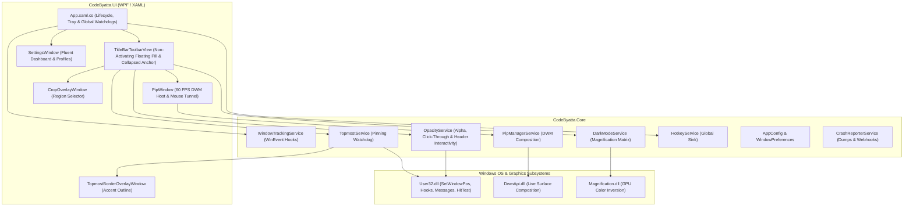

# OpenWindow - Architecture & Design

> **Author & Creator:** CodeByatta ([github.com/codebyatta](https://github.com/codebyatta))  
> **Target Framework:** .NET 8.0 WindowsDesktop (`net8.0-windows`)  
> **UI Framework:** WPF + ModernWpf (Fluent Design)  
> **Deployment Target:** Standalone Native Desktop Application (Windows 10 & 11, x64 and x86)  
> **License:** MIT  

---

## 🏛️ High-Level System Architecture

---

## 🧩 Subsystem Breakdown

### 1. Window Tracking & Non-Activating Toolbar (`TitleBarToolbarView`)
- **WinEvent Hooks:** Uses Win32 `SetWinEventHook` listening to `EVENT_SYSTEM_FOREGROUND` and `EVENT_OBJECT_LOCATIONCHANGE`. Zero polling overhead.
- **`WS_EX_NOACTIVATE` & `WS_EX_TOOLWINDOW`:** Ensures that clicking toolbar buttons (Pin, Opacity, PiP) never steals active keyboard focus or activates the toolbar window itself.
- **Horizontal-Only Constrained Dragging:** In both expanded (`FullToolbarPill`) and collapsed (`AnchorHandle`) modes, drag tracking locks vertically inside the titlebar (`Top = dipTop + 3.0`) and glides horizontally (`Cursor="SizeWE"`), clamped strictly between the left margin (avoiding window icon/tabs) and right margin (avoiding caption controls).
- **Symmetric Target Measurement:** Sizing calculation uses `GetToolbarTargetWidth()` via explicit element measurement rather than stale arrange passes, guaranteeing that expanding and collapsing remains symmetrically anchored at the exact same coordinate.
- **Adaptive Compact Mode:** On windows narrower than 580 DIPs, secondary buttons automatically collapse into compact icon mode.
- **Browser & IDE Tab Avoidance:** Tabbed applications (Google Chrome, Microsoft Edge, Mozilla Firefox, Brave, VS Code) apply dynamic left-boundary offsets so the toolbar never obscures open browser tabs.
- **Per-Window Position Memory:** Computes relative horizontal center ratio (`ArrowCenterRatio` between `0.05` and `0.95`). Automatically remembers positions per process and HWND, surviving minimize/restore cycles by discarding Windows offscreen coordinate anomalies (`X < -10000`).

### 2. Picture-in-Picture (PiP) & Ghost Mode Engine (`PipWindow`)
- **Direct DWM Surface Streaming:** Uses `DwmRegisterThumbnail` and `DwmUpdateThumbnailProperties` for hardware-accelerated 60 FPS live rendering.
- **Ghost Mode:** When streaming an app, OpenWindow applies `WS_EX_LAYERED` with `Alpha = 1` and moves to `HWND_BOTTOM` with `SWP_NOACTIVATE` rather than calling `ShowWindow(SW_HIDE)`.
  - **Why Ghost Mode?** Hiding a window destroys its DWM composition buffer and suspends Chromium/Edge tab timers. Ghost Mode keeps the window 99.6% invisible to human eyes on the desktop while keeping DWM compositor surfaces and browser timers running live at 60 FPS.
- **Comprehensive Interactive Mouse Control (Full & Cropped Modes):**
  - **1:1 Physical Screen Translation:** Uses WPF `PointToScreen` during sub-region cropping to eliminate DWM `rcSource` coordinate drift, DPI scaling offsets, and maximized window negative bounds.
  - **Deep Child Window Traversal:** Searches up to 8 levels deep using `RealChildWindowFromPoint` and `ChildWindowFromPointEx` (filtering out invisible and transparent windows) to deliver inputs directly to leaf controls and Chromium render widgets.
  - **`WM_MOUSEACTIVATE` Dispatch:** Automatically pre-wakes inactive windows and background browsers before mouse button down, ensuring clicks are never dropped.
  - **Mouse Wheel Tunneling:** Uses `PreviewMouseWheel` to bypass WPF container focus blocks; posts `WM_MOUSEWHEEL` (and `WM_MOUSEHWHEEL` with Shift) to child controls and root windows.
  - **Full Button Suite:** Supports left-click, right-click with `WM_CONTEXTMENU`, middle-click, and double-click. Double-clicking the header or thumbnail restores and focuses the original application instantly.

### 3. Smart Opacity & Click-Through (`OpacityService`)
- **Layered Attributes & Transparency Registry:** Manages `WS_EX_LAYERED` and `WS_EX_TRANSPARENT`. Maintains a thread-safe registry of all active transparent windows (`ActiveTransparentWindows`), distinguishing persistent base configured opacity levels from temporary hover reveals.
- **Global Inactive & Background Hover Reveal (`DisableWhenMouseAbove`):** A precision 50ms proximity sensor monitors all registered transparent windows. When the cursor enters the client rect of ANY transparent window (even when inactive, unfocused, or in the background), OpenWindow instantly boosts opacity to 100% (**zero click required!**). As soon as the cursor leaves the window bounds, opacity smoothly reverts to its base configured percentage.
- **Smart Toolbar Hover Exemption:** When the cursor is positioned directly over the floating titlebar toolbar, the window remains transparent, allowing uninterrupted interaction with opacity adjustments or utility controls without visual jumping.
- **Selective Titlebar Interactivity & Header Proximity:** An active 50ms watchdog monitors all active click-through windows. When the cursor hovers or clicks on the upper titlebar, OpenWindow temporarily removes `WS_EX_TRANSPARENT` from the header bar, surfaces the toolbar, and activates the window instantly—completely removing the need to touch the Windows Taskbar!

### 4. GPU Dark Mode Inversion (`DarkModeService`)
- Uses Windows Magnification API (`MagSetFullscreenColorInversionMatrix`).
- Applies a GPU matrix that inverts luminance while preserving color harmonies, instantly turning blinding white applications into comfortable dark mode with 0% CPU impact.

### 5. Standalone Native Distribution Pipeline
- **Zero-Dependency Architecture:** Generates self-contained native binaries for both 64-bit (`win-x64`) and 32-bit (`win-x86`) Windows architectures.
- **1-Click Portable Execution:** Bundles installer, uninstaller, documentation, and SHA-256 integrity checksums so end users on Windows 10 and 11 can run it out of the box without any SDK or runtime prerequisites.

### 6. 1-Click Auto-Updater Subsystem (`UpdateService` & `UpdateDialog`)
- **GitHub Releases REST Ingestion:** Asynchronously queries `https://api.github.com/repos/codebyatta/openwindow/releases/latest` with custom `User-Agent` and semantic version parser.
- **Architecture-Matching Asset Resolution:** Automatically pairs the running operating system architecture (`win-x64` or `win-x86`) with the exact corresponding release bundle.
- **Atomic Out-of-Process Updater:** Downloads the update package with live progress reporting to `%TEMP%\CodeByatta_Updates\`, spawns a detached PowerShell worker that waits for the current process to exit, unpacks the fresh binaries over the installation directory, and re-launches `CodeByatta.UI.exe` seamlessly.

### 7. Taskbar & Shell Immunity Architecture (`ShellSanitizer`)
- **Strict Isolation Barrier:** Intercepts window events and service requests across `TopmostService`, `OpacityService`, `WindowTrackingService`, and hotkeys. Blocks shell classes (`Shell_TrayWnd`, `Shell_SecondaryTrayWnd`, `NotifyIconOverflowWindow`, `TopLevelWindowForOverflowXamlIsland`, `TaskListThumbnailWnd`, `Progman`, `WorkerW`) from being altered.
- **Topmost Priority Enforcer:** Places `Shell_TrayWnd` and `Shell_SecondaryTrayWnd` atop pinned user windows in the Topmost band, ensuring the Windows Taskbar auto-reveals on bottom-edge cursor hovering.
- **Proactive Attribute Sanitization:** Automatically detects and purges stale `WS_EX_LAYERED` / `WS_EX_TRANSPARENT` flags from shell components, restoring full 100% opacity immediately.

### 8. Crash Diagnostics & Telemetry Pipeline (`CrashReporterService` & `CrashReportDialog`)
- **Unhandled Exception Traps:** Hooks `AppDomain.CurrentDomain.UnhandledException`, `DispatcherUnhandledException`, and `TaskScheduler.UnobservedTaskException` to prevent silent crashes and loss of forensic data.
- **Structured JSON Dump Generation:** Writes sanitized exception dumps to `%APPDATA%\CodeByatta\OpenWindow\crash_reports\crash_<timestamp>.json` detailing OS architecture, memory footprint, loaded assemblies, exception hierarchy, and inner stack traces.
- **Developer Telemetry Dispatch:** Supports asynchronous background webhook delivery (Discord, Telegram, and generic HTTP REST) configured via user settings.
- **Next-Boot Diagnostic Dialog:** Evaluates previous session state on startup; if crash dumps are detected, prompts the user via `CrashReportDialog` with options to copy report JSON, inspect dump directory, or dismiss.

---

## 🔒 Threading & Safety Model
- **UI Dispatcher:** All WPF UI operations execute on the main thread via `Dispatcher.Invoke()`.
- **Win32 Message Sink:** Hotkeys run on a dedicated hidden message-only window (`HwndSource`) to prevent hook dropouts.
- **Watchdog Timer:** A 3-second watchdog timer automatically re-enforces topmost z-orders against rogue applications that attempt to steal topmost hierarchy.
- **Resource Hygiene:** Win32 DWM thumbnails, Magnification matrices, and WinEvent hooks are cleanly unregistered on window closure or process termination.

---

## 📚 Related Documentation & Research
- **[FINDINGS.md](FINDINGS.md):** Deep empirical findings covering DWM composition, `SWP_NOACTIVATE`, Ghost Mode, Reddit rate limits, AlternativeTo submission workflows, and Hacker News ingestion.
- **[README.md](README.md):** User guide, installation instructions, keyboard shortcuts, and feature overview.
- **[LAUNCH_POSTS_AND_SEO_CAMPAIGN.md](LAUNCH_POSTS_AND_SEO_CAMPAIGN.md):** Community marketing strategy, live submission tracking, and WindowTop SEO attack plan.
